# agent-silent-failures

[](https://github.com/jj-supercode/agent-silent-failures/actions/workflows/ci.yml)
[](https://www.npmjs.com/package/agent-silent-failures)
[](LICENSE)
[](package.json)

**Deterministic detectors for agent failures that raise no error, shipped as Mastra scorers and measured on real
Claude traces.**

<!-- docs-tables:pitch:start -->

Found along the way: with Mastra's default 4,000-character chunks and `@mastra/fastembed` (a 512-token window), every chunk longer than the window silently loses its tail. On a long book, a median 35.7% of each chunk is never embedded, and a sentence from that tail brings its chunk into the top 5 results 30.8% of the time, against 69.2% for a sentence from the head (scripted; [the lead finding](#the-lead-finding-two-defaults-that-disagree-silently)).

<!-- docs-tables:pitch:end -->

## What it does for you

<!-- docs-tables:uses:start -->

- **Before shipping an index:** `embedding-coverage` reads the ingestion trace and flags text the embedder never sees and chunks left without a vector ([the lead finding](#the-lead-finding-two-defaults-that-disagree-silently)).
    - Example: "fired, severity 0.28: 58 of 77 chunks exceed the 512-token embedder window (longest 938 tokens, chunks up to 4000..." (live session, ingestion trace, no model involved, preset `default-chunk-size`)
- **In CI:** score the traces of an eval run with `scoreTraceBatch` and fail the build on a fired verdict ([measured on a real model](#measured-on-a-real-model)).
    - Example: `pnpm replay` scores 408 committed traces (`recorded`, `claude-haiku-5-5`) offline with no model or key: 0 firings on 312 clean runs.
- **In Studio:** open a trace and pick a detector under "Score trace"; the reason names the spans ([Studio](#try-it-in-studio)).
    - Example: "fired, severity 0.33: rag-agent called searchCorpus 3 times with near-identical arguments (similarity >= 0.8)" (scripted, preset `search-drops-results`)
- **In production monitoring:** score a sample of stored production traces after the fact; retrieval and ingestion faults are caught whatever the model does ([every detector, caught in the act](#every-detector-caught-in-the-act)).
    - Example: "fired, severity 1.00: 2 of 2 retrievals returned rows with no ranking signal (score spread 0.00 in all 2)" (live, `claude-haiku-5-5`, preset `collapsed-embedder`)
- **In multi-agent setups:** catch a supervisor that keeps re-delegating, or answers from its own prior instead of what its workers returned ([delegation-ping-pong](src/entries/delegation-ping-pong/README.md), [ignored-worker-result](src/entries/ignored-worker-result/README.md)).
    - Example: "fired, severity 0.67: supervisor-agent sent the same task to researcher 3 times" (scripted, preset `worker-reply-dropped`)

<!-- docs-tables:uses:end -->

## Why deterministic detectors

- **Cheap and fast.** A detector is a pure function over one stored trace: no model call and no key, so it can score
  every run, not a sample.
- **Same verdict every time, with evidence.** The same trace always gets the same verdict, and a firing names the
  spans and the numbers behind it, so anyone can check it.
- **Measured before it is trusted.** Each detector has a catch rate and a false-alarm rate with intervals, on scripted
  faults and on recorded Claude traces. It complements LLM judges and Mastra's Trace Intelligence: they judge
  meaning, these check the shape of a run.

## Quick start in 60 seconds

```sh
npm install agent-silent-failures    # ESM only; peers: @mastra/core and zod
```

Register the scorers on your Mastra instance, then score any stored trace (or pick them under "Score trace" in
Studio):

```ts
import { scoreTraceBatch } from '@mastra/core/evals/scoreTraces';
import { Mastra } from '@mastra/core/mastra';
import { embeddingCoverageScorer, toolLoopScorer } from 'agent-silent-failures';

export const mastra = new Mastra({
    scorers: { toolLoop: toolLoopScorer, embeddingCoverage: embeddingCoverageScorer },
    // your agents, plus observability with a storage exporter (MastraStorageExporter): without the exporter,
    // no trace reaches storage, even the in-memory store Mastra falls back to
});

/** Scores one stored trace: score 1 means the failure fired, and the reason carries the evidence. */
export const toolLoopVerdict = async (traceId: string) => {
    const storage = mastra.getStorage();
    if (storage === undefined) {
        throw new Error('configure storage, so traces are stored');
    }
    const { results } = await scoreTraceBatch({
        storage,
        scorer: mastra.getScorer('toolLoop'),
        targets: [{ traceId }],
    });
    return results[0];
};
```

Reproduce the measurements offline in one command; the image bakes in the embedding model, so nothing is downloaded
at run time:

```sh
docker build -t agent-silent-failures . && docker run --rm --network none --memory 1g agent-silent-failures
```

## What you need, and the limits

- **Stored traces.** Turn on Mastra observability with a storage exporter: each scorer loads the whole stored trace
  by id, nested tool and sub-agent spans included.
- **Retrieval rows with scores.** Retrieval entries read per-row scores from your search tool's result.
  `@mastra/rag`'s `createVectorQueryTool` works out of the box (`decodeVectorQuerySources`); another shape needs a
  small decoder.
- **After the fact, not a guardrail.** A detector scores a finished trace; it never stops a run. A trace still being
  written makes the scorer throw rather than score clear.
- **Thresholds are measured and yours to change.** Each entry page shows its thresholds with a sensitivity sweep,
  and `createEntryScorer(entry, { thresholds })` overrides them with type checking.

## The lead finding: two defaults that disagree, silently

<!-- docs-tables:headline:start -->

Two Mastra defaults disagree, silently. Each behaves as designed: `@mastra/rag` chunks to 4,000 characters by default, which suits an embedder with a large input window such as `openai/text-embedding-3-small`, the model Mastra's chunking docs use; `@mastra/fastembed` embeds the first 512 tokens of each input, the window of `bge-small-en-v1.5`, and truncates the rest as fastembed and Sentence-Transformers do. Combined, every default chunk longer than the window loses its tail, and `doEmbed` returns no warning. At the 5.0 characters per token measured on the book below, that window holds about 2,500 characters of English prose. On this repository's corpus no document of 2,366 characters or fewer overflowed, and every document of 3,326 or more did. The tail's words never reach the vector, and nothing in Mastra's logs or traces says so.

- **A long public-domain text** (_On the Origin of Species_, 949,181 characters): 249 of 249 default chunks overflow the window (median 793 tokens). The tail past the window is never embedded: a median 35.7% of each overflowing chunk, 36.0% of the corpus. A sentence copied from a chunk's tail can find that chunk only through what the chunk's head says: the chunk is in the top 5 for 30.8% (95% CI 23.3% to 39.6%, n = 120) of such queries, against 69.2% (95% CI 60.4% to 76.7%, n = 120) for sentences from a chunk's head and 83.3% (95% CI 75.6% to 88.9%, n = 120) for the same tail sentences once the text is chunked to fit.
- **This repository's HotpotQA subsample:** question-level contexts (median 6,083 characters) give 58 of 77 default chunks over the window and 27.8% of tokens beyond it. Per-paragraph documents (median 491 characters) give 0 of 386.
- **Mastra Memory semantic recall** with `embedder: fastembed` (top 3) finds a long message from a sentence in its first 512 tokens for 82.1% (95% CI 67.3% to 91.0%, n = 39), and from a sentence after them for 36.8% (95% CI 23.4% to 52.7%, n = 38).
- **The `embedding-coverage` canary** flags the ingestion: held-out `default-chunk-size` ingestions caught 21/24, 87.5% (69.0% to 95.7%); not expressed: 3; caught when expressed 21/21, 100.0% (84.5% to 100.0%). Whether a run lost text is measured apart from the canary: the bed embeds each chunk and its head cut at the window, and the tail was lost when both give the same vector. Where every document fits, nothing was lost and the canary correctly stayed clear.

Short documents are not affected: per-paragraph documents under the same defaults do not overflow. The fix on the user side is a smaller `maxSize`: chunked to 1,500 characters, 0 of the book's 713 chunks pass the window (the largest has 417 tokens). The upstream fix is a warning, written up in [Findings in Mastra](docs/findings-in-mastra.md).

Repro numbers: scripted (offline, no model), darwin 25.6.0 arm64, Node v24.22.0, generated 2026-10-15, @mastra/core 1.77.0, @mastra/evals 1.10.7, @mastra/fastembed 1.3.3, @mastra/libsql 1.26.1, @mastra/memory 1.37.1, @mastra/observability 1.20.0, @mastra/rag 2.6.7, ai 7.0.140. Bed numbers: scripted, darwin arm64, Node v24.22.0, generated 2026-10-15, @mastra/core 1.77.0, @mastra/rag 2.6.7, @mastra/fastembed 1.3.3, @mastra/libsql 1.26.1.

<!-- docs-tables:headline:end -->

Reproduce it offline in one command (the first run downloads the embedding model; the book repro embeds in small
batches, so an ordinary laptop runs it):

```sh
pnpm install && pnpm repros fastembed-truncation-hotpotqa fastembed-truncation memory-fastembed-truncation
```

<picture>
    <source media="(prefers-color-scheme: dark)" srcset="docs/images/charts/retrieval-past-the-window-dark.svg">
    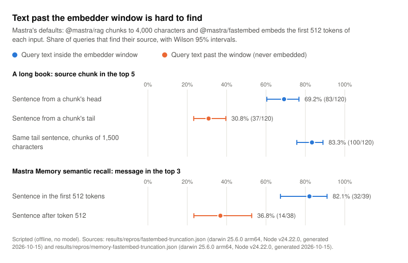
</picture>

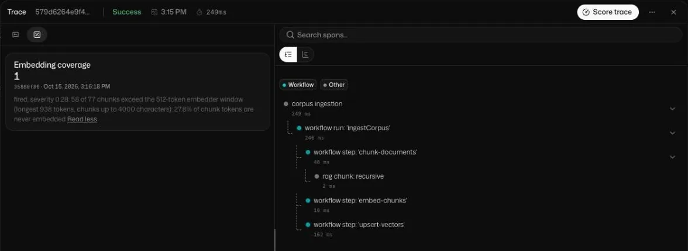

The same finding in Mastra Studio: `pnpm studio:live --fault default-chunk-size` ingests the corpus with Mastra's
default chunking, and `embedding-coverage` fires when the ingestion trace is scored. An ingestion calls no model.

## Measured on a real model

<!-- docs-tables:recorded-lead:start -->

Every run detector was scored on 408 traces recorded from a real model, `claude-haiku-5-5`, on 2026-10-15: 312 clean runs across ordinary questions, search outages, transient tool errors, empty retrievals and a supervisor with two workers, plus runs under infrastructure faults. Scored offline by `pnpm replay`, no detector fired on a clean recorded run. On the recorded infrastructure faults, `flat-score` caught 36/36, 100.0% (90.4% to 100.0%). The first scoring of the same recording found 14 false alarms in `tool-loop` and `ignored-worker-result`. Reading those traces changed detector rules (no threshold value was tuned), so the recorded false alarms below are in-sample: a new recording is the out-of-sample check (see [What the live run taught us](#what-the-live-run-taught-us)).

| Entry                                                                      | False alarms, recorded clean runs (`recorded`) | False alarms, held-out bed (`scripted`) |
| -------------------------------------------------------------------------- | ---------------------------------------------- | --------------------------------------- |
| [embedding-coverage](src/entries/embedding-coverage/README.md)             | not recordable: ingestion calls no model       | 0/288, 0.0% (0.0% to 1.3%)              |
| [flat-score](src/entries/flat-score/README.md)                             | 0/252, 0.0% (0.0% to 1.5%)                     | 0/408, 0.0% (0.0% to 0.9%)              |
| [empty-retrieval-answered](src/entries/empty-retrieval-answered/README.md) | 0/288, 0.0% (0.0% to 1.3%)                     | 0/480, 0.0% (0.0% to 0.8%)              |
| [swallowed-tool-error](src/entries/swallowed-tool-error/README.md)         | 0/312, 0.0% (0.0% to 1.2%)                     | 0/552, 0.0% (0.0% to 0.7%)              |
| [tool-loop](src/entries/tool-loop/README.md)                               | 0/312, 0.0% (0.0% to 1.2%)                     | 0/552, 0.0% (0.0% to 0.7%)              |
| [delegation-ping-pong](src/entries/delegation-ping-pong/README.md)         | 0/96, 0.0% (0.0% to 3.8%)                      | 0/168, 0.0% (0.0% to 2.2%)              |
| [ignored-worker-result](src/entries/ignored-worker-result/README.md)       | 0/87, 0.0% (0.0% to 4.2%)                      | 0/152, 0.0% (0.0% to 2.5%)              |

Recorded: `fixtures/live/2026-10-15`, darwin 25.6.0 arm64, Node v24.22.0, scored offline with the bed's own code. Held-out bed: scripted, darwin arm64, Node v24.22.0, generated 2026-10-15, @mastra/core 1.77.0, @mastra/rag 2.6.7, @mastra/fastembed 1.3.3, @mastra/libsql 1.26.1. Rates with Wilson 95% intervals.

<!-- docs-tables:recorded-lead:end -->

The recorded traces are committed, so `pnpm replay` reproduces every recorded number offline, for free. A clean run
here means the agent was given no fault; when a detector fires on one, that is a false alarm or a real failure of
the model, and its evidence says which.

<picture>
    <source media="(prefers-color-scheme: dark)" srcset="docs/images/charts/detector-reliability-dark.svg">
    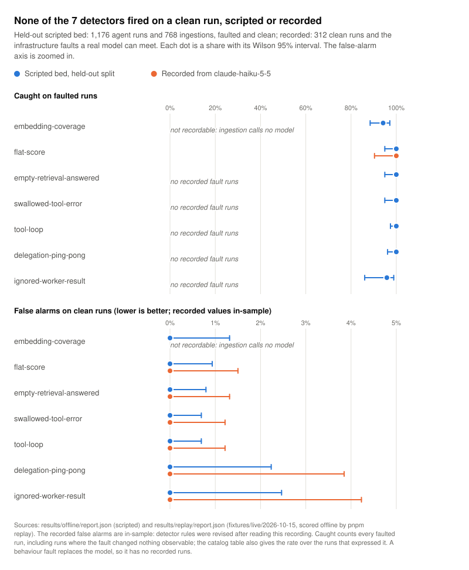
</picture>

## What this is

Most agent failures are loud: an exception, a timeout, a 500. The expensive ones are quiet. The embedder truncates,
the vector side of hybrid search returns constant scores, a tool error comes back as a normal result, a supervisor
re-delegates the same task forever. The answer still looks like an answer, every test that checks types and status
codes passes, and quality drops a little at a time.

This repository is a catalog of those failures, one folder per failure, each with:

1. **a page**: the symptom, why no error is raised, the trace signature, known false alarms and misses, credits;
2. **a detector**: a pure function over a framework-neutral view of one trace (`RunView` or `IngestionView`);
3. **a Mastra scorer**: a code-only `createScorer` scorer that loads the stored trace and runs the detector, so it
   works in Studio trace scoring, `scoreTraces` and CI;
4. **a fault**: a reproduction on an offline Mastra stack, plus clean variations built to tempt the detector.

The test bed runs every detector against every fault and every clean variation and reports catch rate, false-alarm
rate, a cross-fault confusion matrix and threshold sensitivity, all with Wilson 95% intervals.

The idea behind it: **test the shape of results, not only the code.** Each failure here passes unit tests. They
show up only when you look at what real runs produce: score spreads, token counts, how often the same tool is
called with nearly the same arguments. A canary is a cheap, deterministic check on one such shape.

## The catalog

<!-- docs-tables:entries:start -->

| Entry                                                                      | Kind      | Status       | What it catches                                                                                                                         | Held-out catch rate                                                                                        | Held-out false alarms      |
| -------------------------------------------------------------------------- | --------- | ------------ | --------------------------------------------------------------------------------------------------------------------------------------- | ---------------------------------------------------------------------------------------------------------- | -------------------------- |
| [embedding-coverage](src/entries/embedding-coverage/README.md)             | ingestion | stable       | Part of the corpus is silently unsearchable: chunk tails past the embedder window, or chunks without vectors.                           | 113/120, 94.2% (88.4% to 97.1%); not expressed: 7; caught when expressed 113/113, 100.0% (96.7% to 100.0%) | 0/288, 0.0% (0.0% to 1.3%) |
| [flat-score](src/entries/flat-score/README.md)                             | run       | stable       | Retrieval returns rows whose scores are all equal or not numbers, so the ranking carries no signal.                                     | 72/72, 100.0% (94.9% to 100.0%)                                                                            | 0/408, 0.0% (0.0% to 0.9%) |
| [empty-retrieval-answered](src/entries/empty-retrieval-answered/README.md) | run       | stable       | Every retrieval returns no rows, yet the agent answers as if it had found something.                                                    | 72/72, 100.0% (94.9% to 100.0%)                                                                            | 0/480, 0.0% (0.0% to 0.8%) |
| [swallowed-tool-error](src/entries/swallowed-tool-error/README.md)         | run       | stable       | A tool call failed and returned an error as its result, and the agent answered as if it had worked.                                     | 72/72, 100.0% (94.9% to 100.0%)                                                                            | 0/552, 0.0% (0.0% to 0.7%) |
| [tool-loop](src/entries/tool-loop/README.md)                               | run       | stable       | The agent keeps calling the same tool with near-identical arguments, or cycles between two calls, until its step budget runs out.       | 144/144, 100.0% (97.4% to 100.0%)                                                                          | 0/552, 0.0% (0.0% to 0.7%) |
| [delegation-ping-pong](src/entries/delegation-ping-pong/README.md)         | run       | stable       | A supervisor keeps handing the same task back to a worker, or bounces between two workers, ignoring that the work was already returned. | 96/96, 100.0% (96.2% to 100.0%)                                                                            | 0/168, 0.0% (0.0% to 2.2%) |
| [ignored-worker-result](src/entries/ignored-worker-result/README.md)       | run       | experimental | A worker returned the facts, and the supervisor answered from its own prior instead, using none of the worker's result.                 | 46/48, 95.8% (86.0% to 98.8%)                                                                              | 0/152, 0.0% (0.0% to 2.5%) |

Held-out split: 1,176 agent runs and 768 ingestions. Rates with Wilson 95% intervals. Source: scripted, darwin arm64, Node v24.22.0, generated 2026-10-15, @mastra/core 1.77.0, @mastra/rag 2.6.7, @mastra/fastembed 1.3.3, @mastra/libsql 1.26.1.

<!-- docs-tables:entries:end -->

Every rate above is from the held-out split of the scripted bed: families of retrieval settings, query phrasings,
answer and abstention wordings, and supervisor and worker wordings that no threshold was tuned on. The faults are
this project's reproductions, so a high catch rate shows that a detector matches its reproduction across those
variations, not how often the failure occurs in the wild or how often it would be caught there. False alarms on
clean runs, including hard negatives, are the number to watch. Each entry page has its full results block, with
threshold sensitivity, rendered by `pnpm docs:tables` from `results/offline/report.json`.

## What the live run taught us

<!-- docs-tables:live-lessons:start -->

The first scoring of `fixtures/live/2026-10-15` found false alarms no scripted run had shown. Each one was read in its trace, and each fix is a rule about what agents do, tested first on scripted hard negatives and then on the recording. No threshold value was tuned; the one new parameter, `MAX_RETRIES`, is a prior. Every change was derived from this same recording: the two detector rules, how fact words are spelled and where an agent's sentences break (Mastra glues step texts without a space), the added abstention phrases ("I could not search", "I could not check") and the gold-answer metric. So every recorded "Now" value, false alarms and gold answers alike, is in-sample: it shows the fixes work on the traces that revealed the problems, not how they generalise. A new recording is the out-of-sample check. The first scoring and the bed report of its time are kept in `results/replay/first-scoring/`. On the scripted bed, the changed entries catch at least the same share of their faults as before, so the new exemptions did not blunt detection (the counts of `tool-loop` include new fault runs).

| Measure                                                                  | First scoring                     | Now                               |
| ------------------------------------------------------------------------ | --------------------------------- | --------------------------------- |
| `flat-score` false alarms, recorded clean runs (in-sample)               | 0/252, 0.0% (0.0% to 1.5%)        | 0/252, 0.0% (0.0% to 1.5%)        |
| `empty-retrieval-answered` false alarms, recorded clean runs (in-sample) | 0/288, 0.0% (0.0% to 1.3%)        | 0/288, 0.0% (0.0% to 1.3%)        |
| `swallowed-tool-error` false alarms, recorded clean runs (in-sample)     | 0/312, 0.0% (0.0% to 1.2%)        | 0/312, 0.0% (0.0% to 1.2%)        |
| `tool-loop` false alarms, recorded clean runs (in-sample)                | 9/312, 2.9% (1.5% to 5.4%)        | 0/312, 0.0% (0.0% to 1.2%)        |
| `delegation-ping-pong` false alarms, recorded clean runs (in-sample)     | 0/96, 0.0% (0.0% to 3.8%)         | 0/96, 0.0% (0.0% to 3.8%)         |
| `ignored-worker-result` false alarms, recorded clean runs (in-sample)    | 5/96, 5.2% (2.2% to 11.6%)        | 0/87, 0.0% (0.0% to 4.2%)         |
| gold answer found, recorded clean `search-outage` (in-sample)            | 1/9, 11.1% (2.0% to 43.5%)        | 0/12, 0.0% (0.0% to 24.2%)        |
| gold answer found, all recorded clean runs (in-sample)                   | 144/234, 61.5% (55.2% to 67.5%)   | 200/293, 68.3% (62.7% to 73.3%)   |
| `tool-loop` catch rate, held-out bed (`scripted`)                        | 120/120, 100.0% (96.9% to 100.0%) | 144/144, 100.0% (97.4% to 100.0%) |
| `ignored-worker-result` catch rate, held-out bed (`scripted`)            | 46/48, 95.8% (86.0% to 98.8%)     | 46/48, 95.8% (86.0% to 98.8%)     |

- **Parallel retries are not loops.** The model sends two searches at once. When both return an error payload it re-issues both, so the trace reads A, B, A, B, and `tool-loop` called that a cycle on 9 clean runs under search errors. A call that re-issues a failed call is now a retry. A streak of up to `MAX_RETRIES` retries (2, a prior: that many retries after an error is normal recovery) is left out of the loop count; a longer streak counts in full, and so does every repeat after a usable result. The scripted bed checks the rule both ways: the hard negative `parallel-retry` replays the pattern (false alarms 0/48, 0.0% (0.0% to 7.4%)), and the new fault severity `retry-failing-5` loops on a search that always fails (caught 24/24, 100.0% (86.2% to 100.0%)).
- **A supervisor falling back is not ignoring a worker.** Workers whose every search failed said so; the supervisor then abstained, answered from the checker's own source reads, or gave a guess it labelled unverified. `ignored-worker-result` counted the failed replies as facts the answer had to use, and read spelling as invented facts: a possessive ("The Ring's") and an ordinary word capitalised after a colon ("The Ring: Probably yes"). It fired on 5 clean runs, 2 of them on the plain multi-agent baseline, where the answers did use the workers. A worker whose every tool call failed now contributes no facts (a supervision whose every worker failed is not applicable, hence fewer judged runs), and fact words drop the possessive and treat the word after a colon like a sentence opener.
- **No answer hid a failure.** On the recorded clean runs that met a search error, `swallowed-tool-error` fired on 0/48, 0.0% (0.0% to 7.4%): every answer admitted the failure, abstained, or rested on a call that worked.
- **Under a full search outage, the model did not pass off a guess as found.** Single-agent: 12 of 12 answers declined, 0 of them still named the right answer further on, and 0 answered. Multi-agent: 10 of 12 supervisor answers declined, and 4 of those still named the right answer further on, read in each answer as a likely or general-knowledge guess labelled unverified, or as the entry to look up on a retry; 2 answered from tool calls that worked (the checker's source reads: the outage hits search only), and 0 answered with every call failed.
- **The quality column was fooled by abstentions.** "I have no passages about Hot Girls Wanted or China Blue" contains the gold answer of a comparison question, so `gold answer found` read 1/9, 11.1% (2.0% to 43.5%) on recorded clean `search-outage` runs although every answer declined; it now reads 0/12, 0.0% (0.0% to 24.2%). Sentences that decline or report a failure no longer count, an answer whose last step opens by declining finds nothing, yes/no answers are read from their answer word, and a long name matches its usual short form ("Hector Berlioz" for "Louis-Hector Berlioz"). Both gold-answer rows count only the runs where the metric can decide; the rewrite decides more yes/no answers, so the same runs give larger denominators (9 to 12 on `search-outage`, 234 to 293 on all clean runs).

<!-- docs-tables:live-lessons:end -->

<picture>
    <source media="(prefers-color-scheme: dark)" srcset="docs/images/charts/live-run-lessons-dark.svg">
    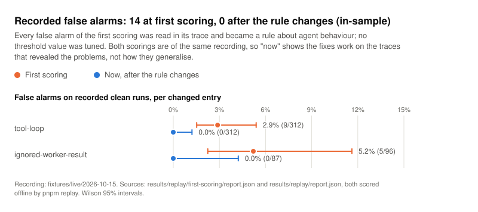
</picture>

## Run the test bed

Requirements: Node 24.22 or newer and pnpm 12 (`corepack enable` picks the pinned version).

```sh
pnpm install
pnpm demo        # a fast bed summary: every fault and clean variation on 3 held-out questions
pnpm bed         # the full bed behind the published rates (dev and held-out splits)
```

Everything is offline: a scripted model, local embeddings (`bge-small-en-v1.5` through `@mastra/fastembed`) and an
in-memory LibSQL store. The first run downloads the embedding model (about 64 MB, once) and embeds the corpus;
later runs reuse an on-disk embedding cache, and a warm `pnpm demo` finishes in well under a minute. The demo shows
the mechanics on a small sample; the published rates come from `pnpm bed`.

With Docker, nothing is downloaded at run time:

```sh
docker build -t agent-silent-failures .
docker run --rm --network none --memory 1g agent-silent-failures                   # pnpm demo
docker run --rm --network none --memory 1536m agent-silent-failures pnpm bed       # the full bed
```

The image bakes in the model and the embedding cache for the demo. A full `pnpm bed` in the container embeds the
other variation families cold, so give it `--memory 1536m`, or keep 1 GB and add `--embedding-batch-size 4`.

## Three ways to run it

| Mode     | Command                                      | Model                          | Cost              | What it shows                                                                                             |
| -------- | -------------------------------------------- | ------------------------------ | ----------------- | --------------------------------------------------------------------------------------------------------- |
| Scripted | `pnpm demo` (3-question summary), `pnpm bed` | scripted policies              | free, offline     | detector mechanics: catch and false-alarm rates on reproducible faults, held-out families, hard negatives |
| Replay   | `pnpm replay`                                | none: scores committed traces  | free, offline     | the same detectors on recorded traces; with a live recording, false alarms under real model variance      |
| Live     | `pnpm demo:live`                             | Claude Haiku 5.5, your API key | capped, see below | regenerates the recorded traces                                                                           |

Every published number is labelled `scripted`, `recorded` or `live`, with the platform, the date and the package
versions that produced it.

### Replay

`pnpm replay` reads the newest committed set under `fixtures/live/` (falling back to `fixtures/dry-run/`) and
scores every run with the bed's own scoring code. It needs no model, key or network and runs in Docker with
`--network none`.

<!-- docs-tables:replay:start -->

Committed set `fixtures/live/2026-10-15`: recorded from `claude-haiku-5-5` on 2026-10-15. Source label: `recorded`. Recorded on darwin 25.6.0 arm64, Node v24.22.0. 408 of 408 planned runs scored, 0 failed while recording, 0 unscorable. Detector rules were revised after reading the first scoring of this recording, so its false alarms are in-sample: a new recording is the out-of-sample check (see [What the live run taught us](#what-the-live-run-taught-us)).

| Entry                    | False alarms on clean runs (in-sample) | Catch rate on recorded faults   |
| ------------------------ | -------------------------------------- | ------------------------------- |
| flat-score               | 0/252, 0.0% (0.0% to 1.5%)             | 36/36, 100.0% (90.4% to 100.0%) |
| empty-retrieval-answered | 0/288, 0.0% (0.0% to 1.3%)             | no recorded fault runs          |
| swallowed-tool-error     | 0/312, 0.0% (0.0% to 1.2%)             | no recorded fault runs          |
| tool-loop                | 0/312, 0.0% (0.0% to 1.2%)             | no recorded fault runs          |
| delegation-ping-pong     | 0/96, 0.0% (0.0% to 3.8%)              | no recorded fault runs          |
| ignored-worker-result    | 0/87, 0.0% (0.0% to 4.2%)              | no recorded fault runs          |

Not in this table: `embedding-coverage`, an ingestion entry; ingestion calls no model, so a recording holds no ingestion traces and its numbers come from the scripted bed alone.

A fault that replaces the model's own behaviour has no live counterpart, so it has no recorded runs; its catch rate comes from the scripted bed.

<!-- docs-tables:replay:end -->

A live recording covers clean runs of the held-out families (including search outages and transient errors, where a real
model can swallow a tool error) and the infrastructure faults a real model can meet (a collapsed embedder, non-finite
scores, zero vectors, an embedding batch cap, Mastra's default chunk size). A detector that fires on a clean live run is
either a false alarm or a real failure of the model, and every verdict carries its evidence, so read it. Recorded traces
keep only what detectors read; `fixtures/README.md` lists every kept field.

### Live (your key, capped)

```sh
cp .env.example .env          # set ANTHROPIC_API_KEY=...
pnpm demo:live --dry-run      # scripted policies: no key, no network, no cost; records to a temporary directory
pnpm demo:live                # records the held-out plan with Claude Haiku 5.5
pnpm replay                   # scores the new set
```

- **Budget guard.** Before any call, the guard reserves that call's worst case and refuses it if it could take the
  run past its own cap or the session past `--max-usd` (default 10). The pre-flight prints the worst case for the
  whole plan and refuses to start above the cap. Actual spend, from the provider's reported usage, goes to
  `spend.json` next to the fixtures. Prices are constants in `src/live/budget/pricing.ts`; check them against the
  provider's pricing page before a run.
- **Retries and network pauses.** A run that fails for a transient reason (a lost connection, HTTP 408, 429,
  500, 502, 503, 504 or 529, an overloaded provider) is attempted again, up to three attempts, a few seconds apart
  with jitter and never sooner than the provider's `retry-after`. Request errors (any other 4xx) and budget
  refusals are never retried. After three transient failures in a row the session prints `waiting for the network`
  and pauses before each attempt (30 seconds, doubling up to 5 minutes); after 30 minutes of one outage it stops
  with exit code 4. Every attempt is paid from the same cap, and `spend.json` lists each retried run.
- **Interrupt and resume.** The manifest and `spend.json` are rewritten after every run, so an interrupted or
  stopped session stays replayable. `pnpm demo:live --resume fixtures/live/<date>` re-runs only that recording's
  failed and missing runs into the same set: completed runs are kept byte for byte and never sent again,
  `--max-usd` caps the whole recording including earlier sessions, and the manifest lists every session. The first
  resume keeps the previous `runs.jsonl` as `runs.jsonl.before-resume` (git-ignored). A resume is refused (exit
  code 7) when the recording's corpus, model, mode or traced package versions differ from the checkout. A session
  never overwrites an existing recording.
- **Key handling.** The key is read from `.env` by one module, only in live mode, and never copied into
  `process.env`. It is read before the session creates its fixture directory, so a missing key refuses the start
  and writes nothing. A test proves that no offline script, test, repro, key-free Studio project or Docker command
  can reach that module or the provider package.
- **Options.** `--max-runs <n>` records a shorter session. `--judge` adds an answer judge; its worst case does not
  fit the default cap for the whole plan, so pair it with a higher `--max-usd` or a lower `--max-runs` (the
  pre-flight prints the worst case before anything is sent).

## Try it in Studio

```sh
pnpm studio         # the scripted agent: no key, no network, no cost
pnpm studio:live    # the same agent on Claude Haiku 5.5: needs ANTHROPIC_API_KEY in .env
```

Both open Mastra Studio at http://localhost:4111 with the RAG agent, the supervisor with its two workers, the corpus and
one scorer per catalog entry. Ask a question in the chat, then open its trace under Observability and score it with any
entry. The agent keeps the last 10 messages of a thread, so a follow-up stays in the same conversation.

| Command            | Model                                                                      | Needs                                    | Cost                                                  |
| ------------------ | -------------------------------------------------------------------------- | ---------------------------------------- | ----------------------------------------------------- |
| `pnpm studio`      | scripted policy: answers with the lead sentences of the top retrieved rows | nothing; never reads `.env`              | free                                                  |
| `pnpm studio:live` | Claude Haiku 5.5                                                           | `ANTHROPIC_API_KEY` in `.env` (see Live) | a fraction of a cent per question, capped per session |

Try these questions; each needs passages from two articles, and the answer cites them as `[S1]`, `[S2]`:

- What Kentucky county has a population of 60,316 and features the Lake Louisvilla neighborhood?
- Which party dominated the last three elections of the state in which Arataca is a municipality?
- Who died first, George Archainbaud or Ralph Murphy?
- Which genus has more species, Monstera or Cercis?

With `pnpm studio:live`, also ask something the corpus does not cover: the instructions tell the agent to abstain.
The scripted agent never abstains while retrieval returns rows, which is one reason scripted runs show detector
mechanics, not answer quality.

**Show a detector firing.** A healthy agent gives most detectors nothing to catch, so both Studio commands take a
fault preset that breaks one thing on purpose, through the same fault code the test bed uses (a fault never edits a
trace):

```sh
pnpm studio --list-faults                    # every preset: what it breaks, which entry should fire, live or scripted-only
                                             # (pnpm studio:live checks the key before it lists)
pnpm studio --fault search-drops-results     # scripted
pnpm studio:live --fault search-errors-lenient
```

While a preset is active, the terminal says so at start and every agent's description, plus the RAG agent's and the
supervisor's display names, carry `[FAULT <preset>]`, so a screenshot cannot pass a broken setup off as a healthy one.
Studio also registers the supervisor with its researcher and checker, so the two multi-agent entries can be shown:
paste a task message (a question, then a `Subjects: A | B` line naming two corpus articles) into the Supervisor
chat. For `default-chunk-size` and `embed-batch-cap`, score the "corpus ingestion" trace instead of a chat.

With `pnpm studio:live`, a preset only breaks infrastructure or configuration and Claude decides what to do about it:

- `collapsed-embedder`, `constant-fused-score`: the vector side stops ranking; `flat-score` fires whatever the model
  does.
- `default-chunk-size`, `embed-batch-cap`: the ingestion itself is broken; no model is involved.
- `filter-key-mismatch` and `search-errors`: empty or failed retrieval. Under the agent's strict prompt, Claude
  usually abstains or says the search failed, which is a correct clear. The `-lenient` variants run a prompt many
  apps ship ("use the search results when helpful", no rule to abstain); there, answering anyway is the failure.
- `search-drops-results`: every search runs and its rows are silently dropped, the symptom of
  [mastra#24110](https://github.com/mastra-ai/mastra/issues/24110) (a token limiter removed the current tool result
  and the agent re-issued the call). `tool-loop` fires if Claude keeps re-issuing the search.
- `worker-reply-dropped`: Mastra's `onDelegationComplete` hook hands the supervisor an empty reply from every worker;
  `delegation-ping-pong` fires if it keeps re-sending the task.
- `supervisor-ignores-workers` is scripted-only: no infrastructure change can make a real supervisor ignore replies
  it did receive. `pnpm studio:live` refuses it.

**Spend cap.** `pnpm studio:live` puts the model behind the same budget guard as `pnpm demo:live`. The session cap is
USD 1 by default; set `STUDIO_LIVE_MAX_USD` to change it (`STUDIO_LIVE_MAX_USD=0.25 pnpm studio:live`). Every call
is held to 40,000 prompt and 1,500 output tokens, and a call whose worst case could cross the cap is refused before
it is sent. The terminal prints the spend after every call. The cap counts per server process, so it starts again
when Mastra reloads after a source edit. Without a key the command refuses to start before Mastra runs. The key is
read by the same single module as `pnpm demo:live`, Mastra's own `.env` loading stays off (`MASTRA_SKIP_DOTENV=1`),
and a test proves that `pnpm studio` cannot reach that module. Run one Studio at a time: both use `.mastra/`.

### What it looks like

These are from `pnpm studio:live` sessions with Claude Haiku 5.5; a fault preset, where one was active, is named
under its image.

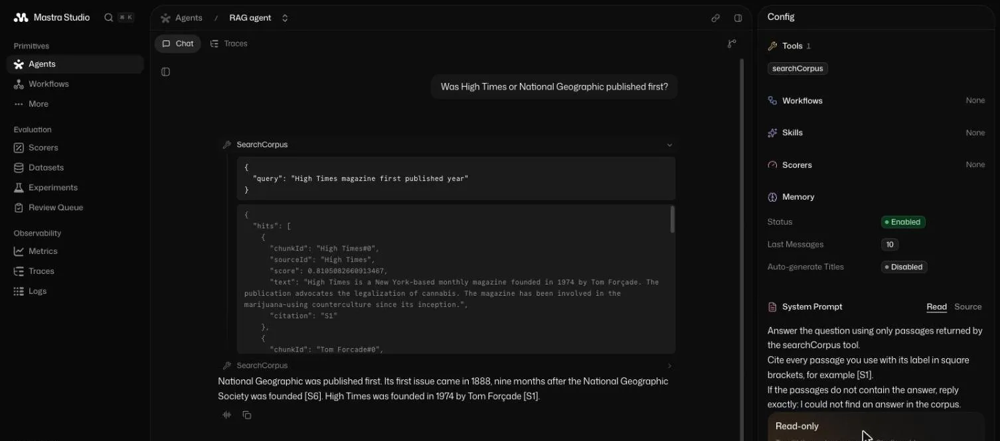

A chat with the tool result expanded: every row carries its score, which is what `flat-score` reads. Each search
takes the next block of top K labels in the order the searches start, parallel calls and a supervisor's workers
included, so with top K 5 the answer cites the second search as S6 to S10 (here [S6] and [S1]). A streamed
parallel-call test and a supervisor test pin this; the labels restart with each new chat message, since Studio runs
each message as its own request.

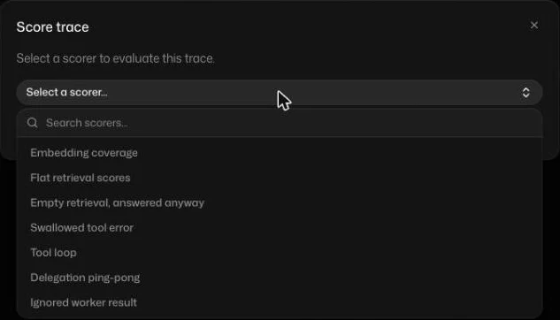

"Score trace" lists one scorer per catalog entry.

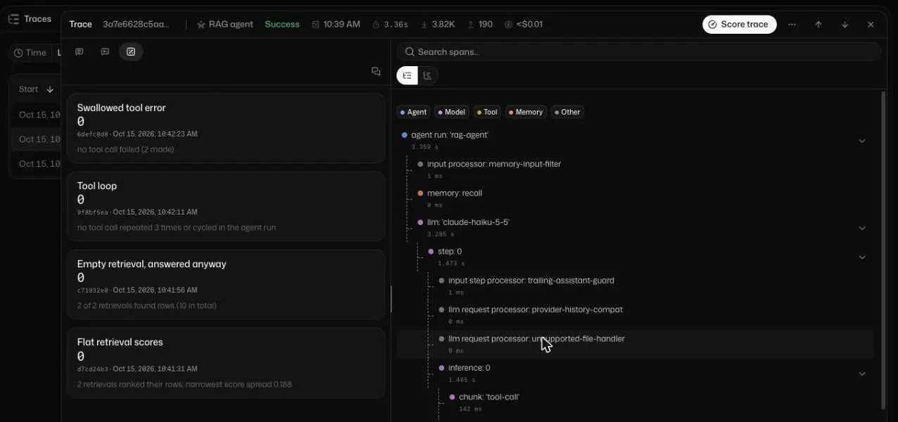

Four run detectors on a real trace, each clear, each with the reason it gives.

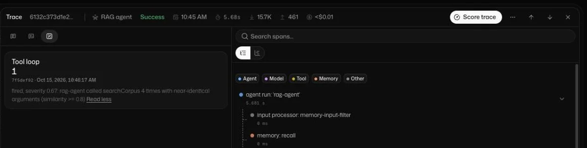

`tool-loop` fired on a real Claude trace. Provoked: the prompt asked for the same search four times.

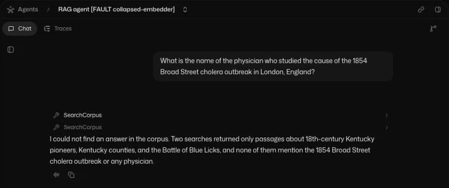

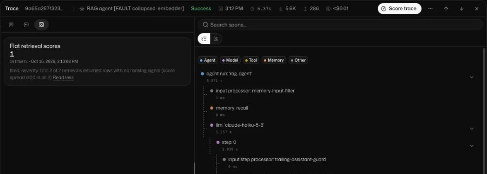

Provoked with `--fault collapsed-embedder`, where every text embeds to the same vector. Claude answers honestly that
it found nothing, which hides the cause; `flat-score` on the same trace names it.

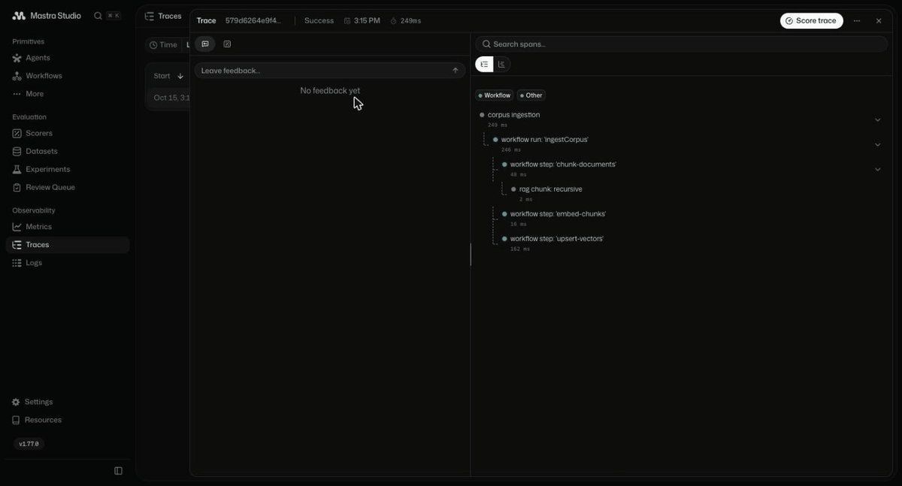

The whole flow on the `default-chunk-size` preset's ingestion trace: open the stored trace, pick a scorer, read the
verdict (sped up about three times).

`pnpm studio:live` shows "Set ANTHROPIC_API_KEY to use this provider" under the chat box. Studio decides that from
`process.env` (`isProviderConnected` in `@mastra/server` 1.77.0), and this project never copies the key into the
environment: the agent's model is built with the key read from `.env`, so chats work. The note only concerns picking
another model in Studio's model menu; the screenshots are cropped above it.

### Every detector, caught in the act

`pnpm demonstration` drives every preset through the Studio agents offline (scripted) and scores each trace the way
Studio's "Score trace" does, through Mastra's trace scoring. `pnpm demonstration:live` runs the same matrix with Claude
Haiku 5.5 behind the Studio spend cap (`STUDIO_LIVE_MAX_USD`, default USD 1); `--dry-run` runs that live path with a
scripted stand-in and costs nothing. Both record every trace, sanitized; the committed recordings are under
`fixtures/demonstration/`, and each column is scored offline from those recorded traces (and checked against Studio's
own verdicts), so `pnpm demonstration --rescore` regenerates the Live column without a model call. `pnpm demonstration`
alone is a rehearsal that records to a temporary directory and changes nothing in the repository; `--write` replaces the
committed scripted recording and result, then re-renders the README blocks and charts, as `--rescore` does.

<!-- docs-tables:demonstration:start -->

Scripted column: model `scripted-policy`, 3 questions per preset (scripted, darwin 25.6.0 arm64, Node v24.22.0 (recording), generated 2026-10-15, @mastra/core 1.77.0, @mastra/observability 1.20.0, @mastra/rag 2.6.7, @mastra/libsql 1.26.1, @mastra/fastembed 1.3.3, ai 7.0.140; scored from the recorded traces in `fixtures/demonstration/scripted/2026-10-15`). Live column: model `claude-haiku-5-5`, 3 questions per preset (recorded, darwin 25.6.0 arm64, Node v24.22.0 (recording), generated 2026-10-16, @mastra/core 1.77.0, @mastra/observability 1.20.0, @mastra/rag 2.6.7, @mastra/libsql 1.26.1, @mastra/fastembed 1.3.3, ai 7.0.140; scored from the recorded traces in `fixtures/demonstration/live/2026-10-16`), USD 0.0181 over 100 model calls.

| Entry                      | Trigger (Studio preset)                                                                                                                                                                                    | Scripted  | Live                        | Evidence                                                                                                                                                               |
| -------------------------- | ---------------------------------------------------------------------------------------------------------------------------------------------------------------------------------------------------------- | --------- | --------------------------- | ---------------------------------------------------------------------------------------------------------------------------------------------------------------------- |
| `flat-score`               | `collapsed-embedder`: every text embeds to the same vector, so every retrieval score is identical                                                                                                          | fired 3/3 | fired 3/3                   | live: fired, severity 1.00: 2 of 2 retrievals returned rows with no ranking signal (score spread 0.00 in all 2)                                                        |
| `flat-score`               | `constant-fused-score`: a fusion layer whose vector leg is dead reports 0.5 for every row                                                                                                                  | fired 3/3 | fired 3/3                   | live: fired, severity 1.00: 2 of 2 retrievals returned rows with no ranking signal (score spread 0.00 in all 2)                                                        |
| `embedding-coverage`       | `default-chunk-size`: long question-level documents ingested with Mastra's default 4,000-character chunks into a 512-token embedder                                                                        | fired 1/1 | fired 1/1                   | live: fired, severity 0.28: 58 of 77 chunks exceed the 512-token embedder window (longest 938 tokens, chunks up to 4000 characters): 27.8% of chunk tokens are...      |
| `embedding-coverage`       | `embed-batch-cap`: the embedder returns 4 vectors for every batch of 8 chunks, with no error                                                                                                               | fired 1/1 | fired 1/1                   | live: fired, severity 1.00: the embedder returned 216 vectors for 431 chunks: 215 chunks have no vector, and the pairing of every other vector to its chunk can no...  |
| `empty-retrieval-answered` | `filter-key-mismatch`: every search filters on a metadata key no row has, so it returns zero rows                                                                                                          | fired 3/3 | not fired 0/3               | live: every retrieval came back empty and the agent abstained                                                                                                          |
| `empty-retrieval-answered` | `filter-key-mismatch-lenient`: every search filters on a metadata key no row has, so it returns zero rows; the RAG agent runs a lenient prompt ("use the search results when helpful", no rule to abstain) | fired 3/3 | not fired 0/3               | live: every retrieval came back empty and the agent abstained                                                                                                          |
| `swallowed-tool-error`     | `search-errors`: every search returns an error payload instead of rows                                                                                                                                     | fired 3/3 | not fired 0/3               | live: 6 of 6 tool calls failed; every failure was recovered, acknowledged or left unanswered                                                                           |
| `swallowed-tool-error`     | `search-errors-lenient`: every search returns an error payload instead of rows; the RAG agent runs a lenient prompt ("use the search results when helpful", no rule to abstain)                            | fired 3/3 | not fired 0/3               | live: 4 of 4 tool calls failed; every failure was recovered, acknowledged or left unanswered                                                                           |
| `tool-loop`                | `search-drops-results`: every search runs, then its rows are dropped before the model reads them: an empty result and no error (the mastra#24110 symptom)                                                  | fired 3/3 | not fired 0/3               | live: no tool call repeated 3 times or cycled in the agent run                                                                                                         |
| `delegation-ping-pong`     | `worker-reply-dropped`: Mastra's onDelegationComplete hook hands the supervisor an empty reply from every worker                                                                                           | fired 3/3 | not fired 0/3               | live: 6 delegations, no repeated task and no unproductive bounce                                                                                                       |
| `ignored-worker-result`    | `supervisor-ignores-workers`: the supervisor answers from its own prior instead of what its workers returned                                                                                               | fired 3/3 | scripted-only, not run live | scripted: fired, severity 1.00: supervisor-agent answered with ingrid, vasquez-tolland, 1611 (found in no prompt, worker reply or tool result) and used none of the... |

An ingestion preset is scored on the session's one ingestion trace; every other preset asks each question once. "Not fired" on a live run means the detector looked and found no failure: the model recovered, or the fault never showed. That is a correct clear, never a miss, and it is reported, not hidden. Live, `flat-score` fired on the chats with `claude-haiku-5-5`. `embedding-coverage` fired on the live session's ingestion, which calls no model. On the presets of `empty-retrieval-answered`, `swallowed-tool-error`, `tool-loop`, and `delegation-ping-pong`, `claude-haiku-5-5` recovered on its own (the evidence column says how), so those detectors correctly stayed clear. They are there for when a model does not recover: weaker models, other providers, prompt changes and regressions; the scripted column shows each of them catching the failure.

<!-- docs-tables:demonstration:end -->

## Use the scorers in your own Mastra app

Install it with `npm install agent-silent-failures` (or pnpm, or yarn). It is ESM only and has two peer dependencies,
`@mastra/core` (`>=1.77.0 <2.0.0`) and `zod` (`>=4.6.7 <5.0.0`).

Register scorers on your Mastra instance. Entries that read retrieval rows are factories, because they need to
know which of your tools retrieves and how to read its output:

```ts
import { Mastra } from '@mastra/core/mastra';
import { createFlatScoreScorer, embeddingCoverageScorer, toolLoopScorer } from 'agent-silent-failures';
import { decodeVectorQuerySources, toolNameSchema } from 'agent-silent-failures/trace';

// An agent that retrieves with @mastra/rag's createVectorQueryTool({ id: 'vectorQuery', ... }).
const retrievalTools = new Map([[toolNameSchema.parse('vectorQuery'), decodeVectorQuerySources]]);

export const mastra = new Mastra({
    scorers: {
        flatScore: createFlatScoreScorer({ retrievalTools }),
        toolLoop: toolLoopScorer,
        embeddingCoverage: embeddingCoverageScorer,
    },
    // agents, storage and observability with a storage exporter, as usual
});
```

- **Custom retrieval tools.** A tool that returns `{ hits: [{ chunkId, sourceId, score, text }] }` uses
  `decodeHitList`; any other shape needs a small `RetrievedRowsDecoder` of your own.
- **Studio.** Open a trace under Observability and score it with a registered scorer. Each scorer loads the whole
  stored trace by `run.targetTraceId`, so it sees nested tool and sub-agent spans (Mastra hands trace scorers only
  the target span). A trace that is missing or still being written makes the scorer throw rather than score clear.
- **Scripts and CI.** `scoreTraces` and `scoreTraceBatch` from `@mastra/core/evals/scoreTraces` work the same way.
  Score 1 means the failure fired and 0 means clear; a fired reason starts with the verdict's severity (0 to 1, how
  much of the run or corpus the failure touches) and carries the evidence. A trace of the wrong kind (an ingestion
  for a run entry) is reported as not scorable.
- **Agents in workflows.** Agents called from a workflow step (by `mastra.getAgent().generate()`, with or without
  `tracingContext`, or as `createStep(agent)`) are scored too: Mastra stores them under a `workflow_run` root, and
  each run scorer judges every agent the workflow called at top level and reports the worst verdict.
- **Ingestion.** `embedding-coverage` reads the report your ingestion records as the output of a `rag_ingestion`
  span (`startRagIngestion` or `withRagIngestion`). `agent-silent-failures/ingestion` builds that report from your
  own chunks and vectors (pure functions, no runtime dependency); the entry page shows how to count tokens with
  `@mastra/fastembed`'s own tokenizer.

Each entry page shows its own options and thresholds. To score with other thresholds, build a scorer with typed
overrides: `createEntryScorer(toolLoopEntry, { thresholds: { MIN_REPEATS: 5 } })`; a misspelt threshold name does
not compile.

## How the bed measures honestly

- **Held-out families.** Variation families are split into dev and held-out. They vary retrieval settings (top K,
  chunk size), the question phrasing, the answer wording and the abstention sentence; on the multi-agent harness
  they also vary how the supervisor phrases research requests, how it words its answer, and how workers word their
  replies. The task mix and the two worker roles are the same in both splits. Thresholds are priors or invariants,
  never tuned on held-out runs, and only held-out numbers are published.
- **Hard negatives.** The clean pool includes runs built to tempt each detector: a transient search error the agent
  retries correctly, a search outage it reports honestly, an empty retrieval it abstains on, paginated reads,
  near-identical searches about different entities, duplicated paragraphs with exact score ties, Mastra's default
  chunking over short documents.
- **Information wall.** A detector may import only the trace model, the shared pure text helpers and its own model. The
  wall is enforced twice: ESLint rejects any other import in a detector (and any `import()`), and
  `src/entries/detector-wall.test.ts` walks each detector's runtime import graph and fails on anything beyond
  `src/trace/model.ts`, `src/text/*`, the entry's own `model.ts`, `contract.ts`, `errors.ts` and zod. Faults change
  harness mechanisms (embedder, retriever, tool output, model policy), never traces, so a detector cannot read a fault
  label.
- **Cross-fault confusion matrix.** Every detector is scored on every other entry's faults, so overlap shows up
  (a collapsed embedder rightly trips both `flat-score` and `embedding-coverage`).
- **Threshold sensitivity.** Each threshold is swept, and catch and false-alarm rates are reported per value.
- **Not expressed is not missed, and it is measured apart.** A fault can apply and still change nothing on a run:
  Mastra's default chunk size over a question whose documents all fit the embedder window loses no text, and an
  embedding batch cap that happens to fall past the last chunk drops no vector. The bed decides whether a fault
  took effect without reading what the detector reads: it embeds each chunk and its head cut at the window with
  the real embedder (the tail was lost when both give the same vector), counts the rows the vector store holds
  against the chunks the chunker produced, and counts stored rows no query can reach. It reports caught over every
  run, how many runs did not express the fault, caught when expressed, and any run where the detector fired
  although no effect was observed.
- **Stated limit.** High catch rates on faults that replace the model's own behaviour (tool loops, swallowed
  errors, ping-pong, ignored workers, answering from memory) hold largely by construction: the detector and the
  scripted behaviour were written by the same project, a caveat "Fidelity Is Not Enough"
  ([arXiv 2608.28439](https://arxiv.org/abs/2608.28439)) also makes about its own rule detector. Held-out families
  and hard negatives narrow that gap without closing it. The out-of-distribution check is replay of traces
  recorded from a live model, where these detectors meet behaviour nobody scripted. The committed recording has
  since been used to revise rules (see [What the live run taught us](#what-the-live-run-taught-us)), so its numbers
  are now in-sample; the next recording is the out-of-distribution check. Every entry page lists its known misses.

Full tables: `results/offline/report.md` (scripted bed) and `results/replay/report.md` (replay).

## Findings in Mastra

Building this turned up a few silent failures inside Mastra itself, each with an offline repro under `repros/` and
a suggested fix, plus a few that looked like bugs and are not (for example, Mastra's documented ingestion pattern
correctly refuses mismatched vector and metadata counts). The first four, to be reported upstream:

1. Default 4,000-character chunks and `@mastra/fastembed`'s 512-token window disagree, and `doEmbed` returns no
   warning (the headline above): each default is sound alone; the ask is a warning and documentation.
2. Trace scoring gives `type: 'agent'` scorers no tool calls.
3. `runEvals` scores the message trajectory, not the trace, even with storage configured.
4. The redundant-call check never fires on trace-derived trajectories.

Details, source references, the second batch and the checked non-bugs: [docs/findings-in-mastra.md](docs/findings-in-mastra.md).

## Credits and prior art

None of these failure patterns is new; what this project adds is a per-failure fault, a deterministic Mastra
scorer and measured rates. The patterns were observed in production agent work and are credited where published:

- **Score-distribution signals** for `flat-score`: score-gap and spread signals for retrieval abstention, "The
  Magnitude Mirage" ([arXiv 2609.15578](https://arxiv.org/abs/2609.15578)).
- **Citation entropy**, behind the wanted citation entry: CiteRAG's Citation Diversity Entropy
  ([arXiv 2601.14949](https://arxiv.org/abs/2601.14949)).
- **Empty and degraded tool steps** for `empty-retrieval-answered`: [CorruptChain](https://github.com/royhasenfratz/CorruptChain).
- **Exact adjacent tool repeats**, which `@mastra/evals` `noRedundantCalls`
  ([docs](https://mastra.ai/reference/evals/trajectory-accuracy)) and DeepEval's `AgentLoopDetectionMetric`
  ([docs](https://deepeval.com/docs/metrics-agent-loop-detection)) already cover; `tool-loop` catches them too, and
  adds near-identical arguments, non-adjacent repeats and A-B-A-B cycles.
- **Measured fault benchmarks**: AgentTelemetry ([repo](https://github.com/Krishnachaitanyakc/AgentTelemetry),
  [paper](https://doi.org/10.1145/3805760.3814931)), with injected faults and detection rates for its own
  telemetry schema, and Dubey, "Real-Time Detection and Repair of LLM Agent Failures"
  ([arXiv 2608.02464](https://arxiv.org/abs/2608.02464)), with aggregate catch and false-alarm rates.
- **Failure taxonomies**: MAST, Cemri et al. ([arXiv 2503.13657](https://arxiv.org/abs/2503.13657)), and the
  prose catalogs [vectara/awesome-agent-failures](https://github.com/vectara/awesome-agent-failures) and
  [muhammadwaqar12/awesome-agent-failures](https://github.com/muhammadwaqar12/awesome-agent-failures).
- **Silent embedder truncation** is long documented: the Sentence-Transformers docs and Ollama
  [#14259](https://github.com/ollama/ollama/issues/14259).

Each entry page cites its own references with dates.

## Limits

- **Reproductions, not prevalence.** Catch rates measure detectors against this project's faults. How often each
  failure happens in real systems is not measured here.
- **One corpus, one language.** The bed uses a 40-question HotpotQA subsample in English. Token-per-character
  ratios, and so the overflow boundary, differ for code, tables and other languages.
- **Scripted wording.** Abstention and failure-acknowledgement matching is tested on a committed set of common model
  phrasings (in `src/text/abstention.test.ts`), and the held-out families abstain in sentences no dev family uses;
  coverage of a real model's phrasing still comes only from a live recording.
- **Mastra versions.** Mastra ships several minor releases a week. Everything here is pinned and measured on the
  versions listed with each number; `pnpm repros` tells you when an upstream behaviour changes.
- **Experimental entry.** `ignored-worker-result` is experimental: it has known misses when workers return
  overlapping results.

## Roadmap (planned)

- **A framework-neutral core.** `agent-silent-failures` holds the detectors and views with zod as its only peer;
  `agent-silent-failures/mastra` holds trace loading and the scorers, with `@mastra/core` an optional peer.
- **Conversational and realtime runs**, for realtime and voice agents: a timeline of user and assistant utterances,
  tool calls (including results held and released later), timestamps and the reason a run ended.
- **Versioned verdicts.** Each verdict records `entryId@version` and the thresholds in effect.
- **New entries:** a directive in a tool result that the agent ignored, a write with a value no tool or user
  supplied, the same question asked again with nothing new in between, a run that ended before its final commit,
  and language drift.
- **Contributions wanted:** an OpenTelemetry GenAI adapter, and a citation-filter-drop entry (top-scored rows from
  other sources that are never cited).

## Contributing

Adding a failure to the catalog takes an afternoon: a fault, a detector, a scorer and a page, and the bed scores it.
See [CONTRIBUTING.md](CONTRIBUTING.md).

## Development

```sh
pnpm check             # typecheck, lint, format:check, unit and integration tests, package build and install smoke
pnpm test              # unit tests: pure and fast, every *.test.ts except *.integration.test.ts
pnpm test:integration  # real fastembed, LibSQL and Mastra, one worker
pnpm bed               # the full test bed; --entry <id>, --split dev|held-out|all, --write-results
pnpm repros            # the upstream repros (not part of pnpm check)
pnpm docs:tables       # renders the generated blocks of this README, docs/ and every entry page; --check fails when stale
pnpm docs:charts       # renders the README charts (SVG, light and dark) from the results; --check fails when stale
pnpm studio            # Mastra Studio over the scripted agent and every scorer (never loads .env)
pnpm studio:live       # the same Studio on Claude Haiku 5.5, behind a spend cap (reads the key from .env)
pnpm demonstration     # every Studio fault preset, scripted (a rehearsal); --write updates fixtures, results, docs
pnpm demonstration:live  # the same matrix on Claude Haiku 5.5 behind the Studio cap; --dry-run costs nothing
```

- **Two TypeScript versions, on purpose.** TypeScript 7 is the native compiler and ships no JavaScript API, while
  typescript-eslint needs the TypeScript 6 API. Following "Running Side-by-Side with TypeScript 6.0" in the
  [TypeScript 7.0 announcement](https://devblogs.microsoft.com/typescript/announcing-typescript-7-0/), `typescript`
  is an alias of `@typescript/typescript6` (used by ESLint) and `@typescript/native` is an alias of
  `typescript@7.0.2`, which provides the `tsc` that `pnpm typecheck` runs.
- **Test split.** Name a test `*.integration.test.ts` when it runs real embeddings, a vector store or a Mastra
  agent; everything else must stay pure and fast.
- **Memory.** `@mastra/fastembed` pads every input to 512 tokens, so cold embedding is memory hungry and grows with
  the batch. `--embedding-batch-size 4` lowers the peak below the default batch of 8; a larger batch is faster and
  needs more.
- **Generated numbers.** Never edit a number inside a `docs-tables` or `results` block by hand: run
  `pnpm bed --split all --write-results`, `pnpm replay`, `pnpm repros`, then `pnpm docs:tables` and `pnpm docs:charts`.

## For agents and CI

Every command (`demo`, `bed`, `replay`, `repros`, `docs:tables`, `docs:charts`, `demo:live`, `demonstration`,
`demonstration:live`, and the `studio:live` preflight) talks in one of three modes, so a person at a terminal and a
script reading the output each get what suits them.

| Mode    | Chosen by                                | What it prints                                                                                                 |
| ------- | ---------------------------------------- | -------------------------------------------------------------------------------------------------------------- |
| `human` | a terminal (stdout is a TTY, `CI` unset) | a styled header, one progress line rewritten in place (elapsed, ETA, spend), aligned tables, a closing summary |
| `plain` | a pipe, a file, `CI`, or `--plain`       | no ANSI and no rewritten lines; every line outside a table starts with a stable prefix; progress every 10%     |
| `json`  | `--json`                                 | newline-delimited JSON events on stdout and nothing else; logs and stack traces go to stderr                   |

`AGENT_SILENT_FAILURES_OUTPUT=human|plain|json` sets the mode for every command; `--json` and `--plain` override it,
and both override detection. Colour follows `NO_COLOR` and `FORCE_COLOR`. `--help` on any command prints its flags
and exit codes. `pnpm studio` and `pnpm studio:live` take `--fault` and `--list-faults` and pass every other argument
to `mastra dev`, so set the `studio:live` preflight's mode with the variable.

Plain lines start with `start:`, `measures:`, `progress:`, `warning:`, `failure:`, `section:` (followed by indented
rows), `summary:`, `time:`, `spend:`, `wrote:`, `next:` and `exit:`. A failure reads
`failure: <what> (<subject>): <why>; fix: <fix>`; an invalid command line is a failure whose fix is the usage.

### JSON events

Each line is one event. Every event has `schemaVersion`, `command` (such as `bed`), `event` and `elapsedMs`
(milliseconds since the command started). A reader may stop early (`| head -1`): the command drops the rest of its
output and still finishes its work. The schema is `commandEventSchema` in `src/command-output/model.ts`; the
version changes whenever a consumer could notice.

<!-- command-line:schema-version:start -->

Current `schemaVersion`: `1`.

<!-- command-line:schema-version:end -->

| `event`    | Fields                                                                                                                                                                                                                                     |
| ---------- | ------------------------------------------------------------------------------------------------------------------------------------------------------------------------------------------------------------------------------------------ |
| `start`    | `title`, `description` (what will happen), `measures` (what the numbers mean, or `null`), `total` and `unit` (planned work, or `null`), `facts` (camelCase keys such as `stack` or `spendCap`, string values)                              |
| `progress` | `done`, `total`, `failed`, `unit`, `etaMs` (or `null`), `spendUsd` (or `null`); emitted at every tenth of the work                                                                                                                         |
| `warning`  | `message`, `details` (strings)                                                                                                                                                                                                             |
| `failure`  | `subject` (a run id, page or repro, or `null`), `what`, `why`, `fix` (or `null`); one per failed unit, as it happens                                                                                                                       |
| `summary`  | `ok`, `exitCode`, `exitMeaning`, `headline`, `counts` (numbers by name, such as `scoredRuns` or `capUsd`), `rates`, `spendUsd` (or `null`), `outputs` (paths written), `next` (`command`, `purpose`), `peakRssBytes`; always the last line |

Values in JSON are exact; the human and plain modes round them. A rate is
`{ group, subject, measure, events, trials, share, interval: { lower, upper } }`, where `group` is the split,
`subject` the catalog entry, `measure` one of `caught`, `caught-when-expressed` and `false-alarms`, `share` is
`events / trials` (or `null` with no trials) and `interval` the Wilson 95% interval. For example, the held-out catch
rates of one entry:

```sh
pnpm bed --split held-out --entry tool-loop --json \
  | jq -c 'select(.event == "summary") | .rates[] | select(.measure == "caught")'
```

### Exit codes

Each command returns one meaning per code; `2` and `70` mean the same everywhere.

<!-- command-line:exit-codes:start -->

| Command                   | Code | Meaning                                                                                            |
| ------------------------- | ---- | -------------------------------------------------------------------------------------------------- |
| `pnpm demo`, `pnpm bed`   | 0    | every planned run was scored                                                                       |
| `pnpm demo`, `pnpm bed`   | 1    | at least one run failed; each is reported, and no results file is written                          |
| `pnpm demo`, `pnpm bed`   | 3    | the committed question corpus could not be read                                                    |
| `pnpm replay`             | 0    | every recorded run was scored                                                                      |
| `pnpm replay`             | 1    | at least one recorded run could not be scored; each is reported                                    |
| `pnpm replay`             | 3    | the committed question corpus could not be read                                                    |
| `pnpm replay`             | 4    | no readable fixture set: none committed, or the one named is invalid                               |
| `pnpm replay`             | 5    | the fixture set was recorded on another corpus; nothing was scored                                 |
| `pnpm repros`             | 0    | every selected behaviour still reproduces                                                          |
| `pnpm repros`             | 1    | a behaviour no longer reproduces (changed upstream?) or a repro broke                              |
| `pnpm docs:tables`        | 0    | every page is up to date or was just updated                                                       |
| `pnpm docs:tables`        | 1    | --check found a page out of date or missing its block markers; nothing was written                 |
| `pnpm docs:tables`        | 3    | a committed result file is missing or does not match its schema                                    |
| `pnpm docs:charts`        | 0    | every chart is up to date or was just written                                                      |
| `pnpm docs:charts`        | 1    | --check found a chart out of date or missing; nothing was written                                  |
| `pnpm docs:charts`        | 3    | a committed result file is missing or does not match its schema                                    |
| `pnpm demo:live`          | 0    | every planned run was attempted; a failed run is recorded with its reason                          |
| `pnpm demo:live`          | 3    | the pre-flight worst case is above --max-usd; nothing was sent                                     |
| `pnpm demo:live`          | 4    | the session stopped early; everything recorded is replayable and resumable                         |
| `pnpm demo:live`          | 5    | the target directory already holds a recording; nothing was sent                                   |
| `pnpm demo:live`          | 6    | no ANTHROPIC_API_KEY in .env; nothing was sent                                                     |
| `pnpm demo:live`          | 7    | the recording cannot be resumed with this checkout; nothing was sent                               |
| `pnpm demo:live`          | 8    | the committed question corpus could not be read; nothing was sent                                  |
| `pnpm studio:live`        | 0    | the key and the spend cap are valid; Studio starts                                                 |
| `pnpm studio:live`        | 6    | no ANTHROPIC_API_KEY in .env; nothing was sent                                                     |
| `pnpm demonstration`      | 0    | every Studio preset's entry fired on its scripted traces                                           |
| `pnpm demonstration`      | 1    | a preset's entry did not fire on its scripted traces; each is reported                             |
| `pnpm demonstration`      | 3    | the committed question corpus could not be read                                                    |
| `pnpm demonstration`      | 4    | a recording to re-score under fixtures/demonstration/ is missing or unreadable                     |
| `pnpm demonstration`      | 5    | the recorded traces scored differently from Studio's trace scoring; each preset is reported        |
| `pnpm demonstration:live` | 0    | every live-capable preset was driven; a preset whose entry did not fire is reported, not a failure |
| `pnpm demonstration:live` | 5    | the target directory already holds a recording; nothing was sent                                   |
| `pnpm demonstration:live` | 6    | no ANTHROPIC_API_KEY in .env; nothing was sent                                                     |
| `pnpm demonstration:live` | 8    | the committed question corpus could not be read; nothing was sent                                  |
| every command             | 2    | the arguments or settings could not be read; nothing was run                                       |
| every command             | 70   | an unexpected error (a bug); the failure names it                                                  |

<!-- command-line:exit-codes:end -->

## How this was built

Built in 14 waves by 23 coding agents on Claude Opus 5.5, directed by the author. Each agent worked from a written
specification, had its work reviewed and had to pass a green gate; three independent read-only audits checked the
code, the claims and the release. Review fixed 350 defects before release, and real-model runs
caught problems the scripted bed could not. Every number in this README is regenerated from committed data. The
process, token use and cost are in [docs/how-this-was-built.md](docs/how-this-was-built.md).

## Licence

Code: MIT, see [LICENSE](LICENSE). The HotpotQA subsample in `data/hotpotqa/` is CC BY-SA 4.0 (Yang et al., EMNLP
2018); see `data/hotpotqa/README.md` for its source, sampling method and changes. `repros/corpus/` holds a Project
Gutenberg eBook, public domain in the USA, redistributed unchanged with its licence.
